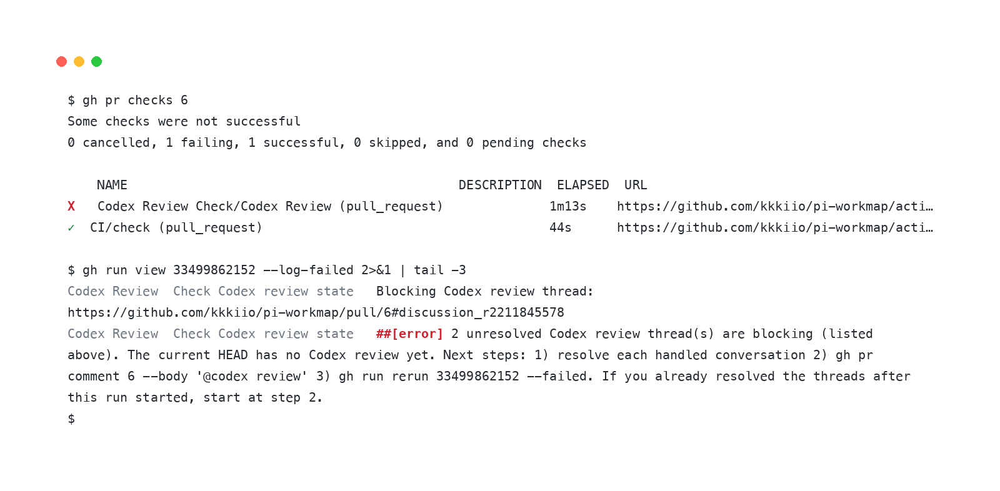
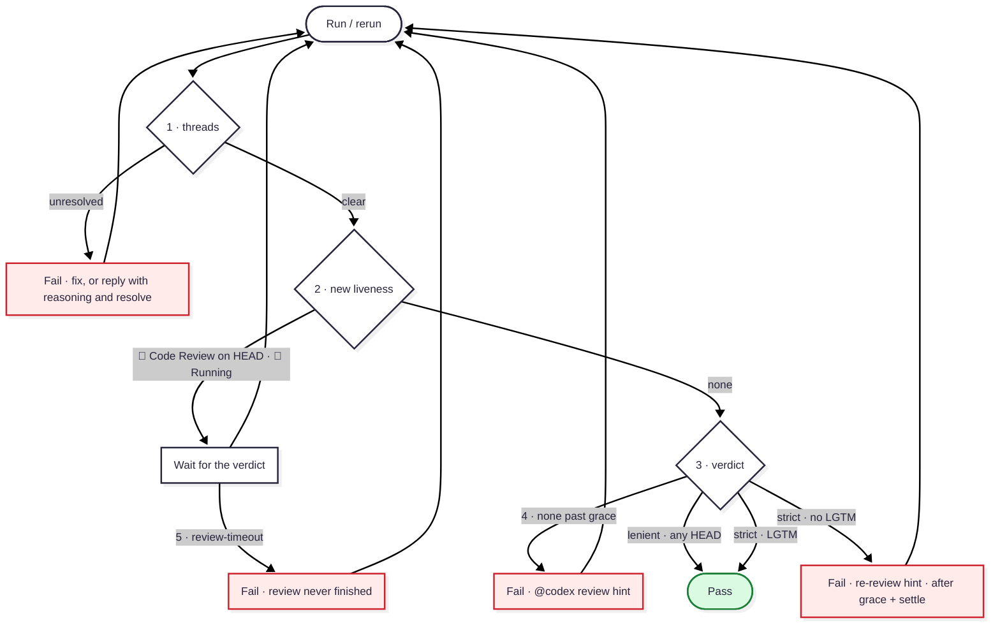

# Codex Review Check

<p align="center">
  
</p>

Codex Review Check is a read-only, credit-aware GitHub Action that guides agents through the Codex review loop: a completed review holds the quality floor by default, and `require-lgtm: true` raises the bar to a current-HEAD Codex LGTM.

## Installation

1. Copy the ready-to-use [`examples/codex-review-check.yml`](examples/codex-review-check.yml) into the consuming repository as `.github/workflows/codex-review-check.yml`.
2. Enable Codex code review for the repository with the **On pull request** trigger, so each pull request receives an initial review.

## Usage

Once installed, your agent needs no special instructions beyond checking PR status as usual:

```shell
gh pr checks --watch
```

When the gate fails, the agent inspects the failed run and gets the exact command chain to run next:

```console
$ gh run view --log-failed
...
##[error]No Codex review signal for current HEAD 821c759c9c3256e8a677800dbe8e4a88ae5e2ab0. Request one and run these back to back, without waiting in between: gh pr comment 42 --body '@codex review' && gh run rerun 33499862152 --failed && gh pr checks 42 --watch. The re-run check itself waits up to 30 min for the Codex review to finish, then passes or reports the next action. Start it right away and wait on the check; read Codex reviews or comments directly only if the check result looks wrong.
```

The Action never spends Codex credits itself — when a later push needs a fresh review, the failure output tells the agent to request one with `gh pr comment <PR> --body '@codex review'` before re-running the gate.

The check follows this state model — the loop over time:



And its evaluation order — each evaluation stops at the first match:

```text
1 · unresolved Codex threads    → fail · fix, or reply with reasoning and resolve
2 · a newer review is running   → wait (📝 Code Review on HEAD · 🔄 Running, or a fresh @codex review)
3 · completed verdict           → pass (usually ✅ Completed)
      lenient (default):  latest verdict, any HEAD
      require-lgtm:       LGTM on the current HEAD — a verdict without an LGTM fails with a re-review hint after grace + settle
4 · nothing after grace-seconds → fail · @codex review hint
5 · review never finishes       → fail at review-timeout-seconds
```

## Configuration

See [configuration, outputs, and reruns](docs/CONFIGURATION.md).

## License

[Apache License 2.0](LICENSE)
